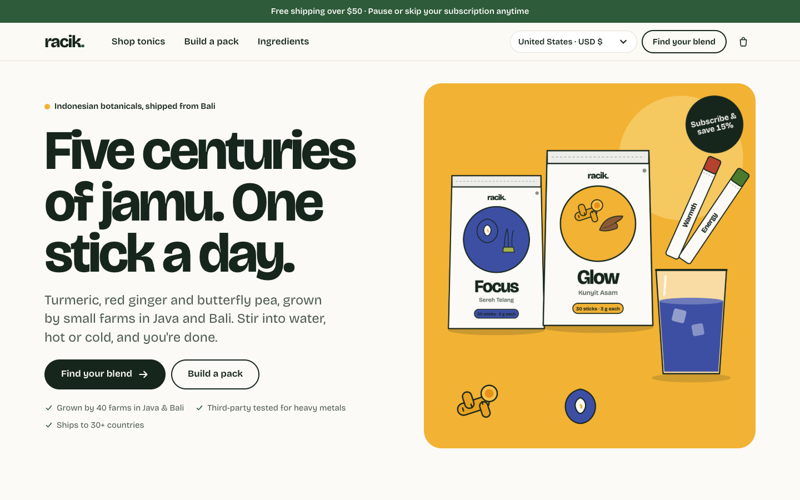
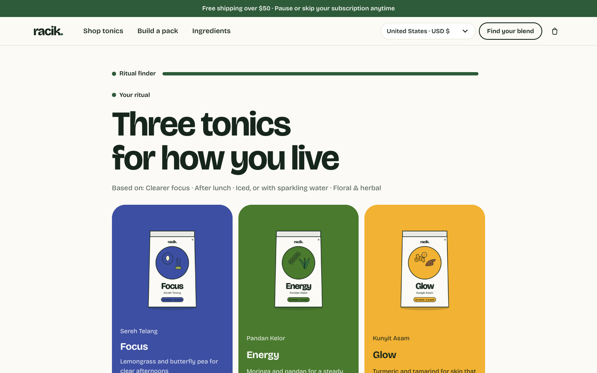
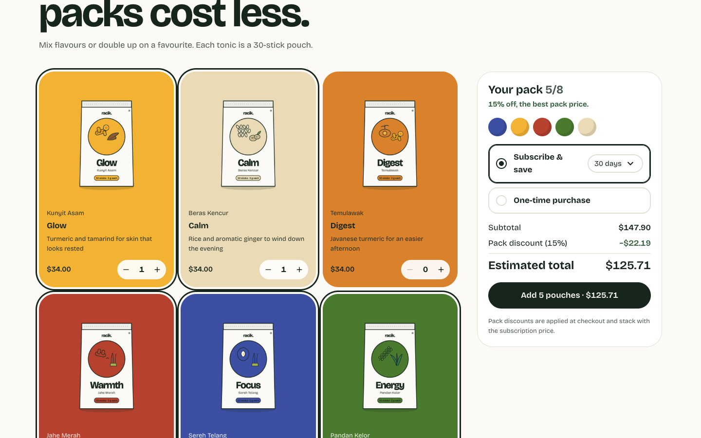
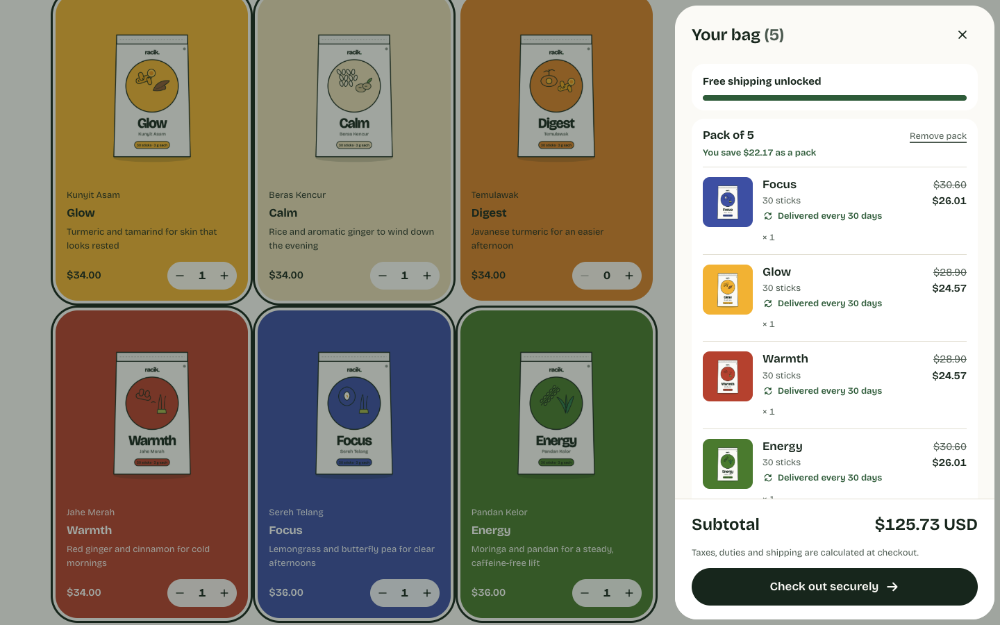
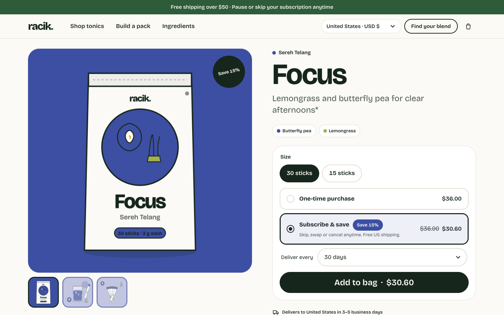
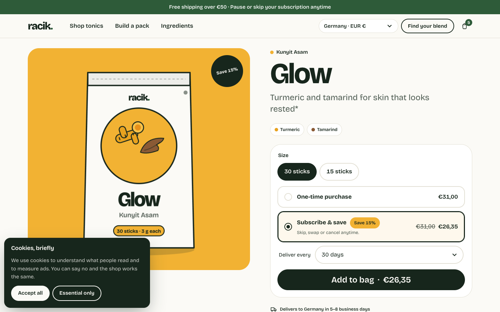
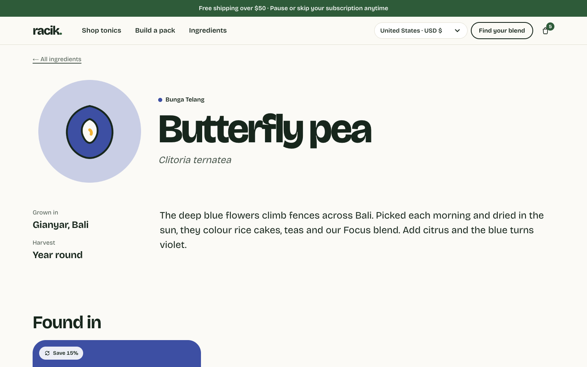
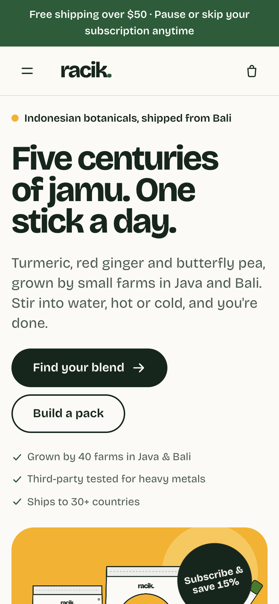
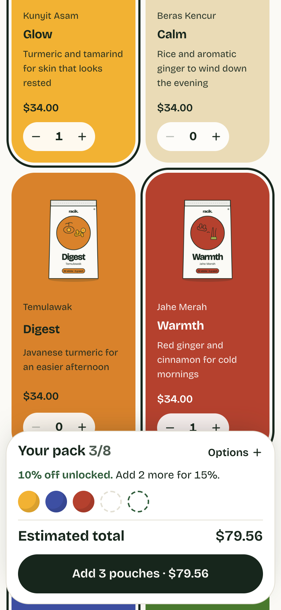
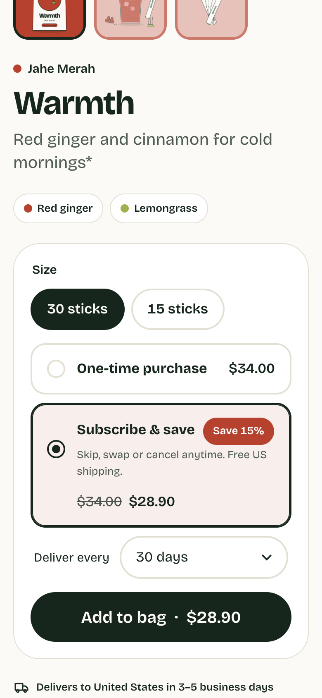

# Racik — Shopify store build

A Shopify build for **Racik**, a fictional Indonesian wellness brand that sells jamu (traditional herbal tonics) to the US, UK, EU and Australia. It covers the three patterns most direct-to-consumer brands ask for: a **product quiz**, **build-your-own bundles** and **subscribe & save**. All three run on a custom theme with metaobjects and Shopify Markets.

**▶ 75-second demo: [geffaa.github.io/racik-shopify](https://geffaa.github.io/racik-shopify/)**

[](https://geffaa.github.io/racik-shopify/)

| | What | Stack |
|---|---|---|
| [`theme/`](theme) | Custom Online Store 2.0 theme, built from scratch | Liquid, CSS, vanilla JS (Web Components) |
| [`extensions/pack-discount/`](extensions/pack-discount) | Tiered bundle discount | Shopify Discount Function (JavaScript), tiers stored in a metafield |
| [`scripts/`](scripts) | Seeds a dev store: products, selling plans, metaobjects, pages, the discount | Admin GraphQL API |
| [`design/`](design) | Generates every product image (pouches, drinks, botanicals) | SVG → PNG via headless Chrome |
| [`preview/`](preview) | Renders the theme offline and runs end-to-end checks | liquidjs, Puppeteer |

---

## The three flows

### 1. Product quiz → recommendation
`/pages/quiz` uses [`sections/main-quiz.liquid`](theme/sections/main-quiz.liquid) and [`assets/quiz.js`](theme/assets/quiz.js).

- **Merchant-editable.** Each question is a block in the theme editor. Answers are written as `Label | tag, tag` and match **product tags** (`goal:focus`, `time:afternoon`, `serve:cold`, `taste:floral`), so merchandising can change the quiz without a developer.
- **Results** show three tonics with the answers they matched. The last result is remembered in the browser, and "Build this pack" sends the picks straight into the pack builder.
- **Guarded by a test.** A unit test fails if any quiz answer points at a tag that no product carries, which is the most common way quizzes break quietly.



### 2. Build-your-own pack → priced by a Shopify Function
`/pages/build-a-pack` uses [`sections/main-pack.liquid`](theme/sections/main-pack.liquid) and [`assets/pack.js`](theme/assets/pack.js). The discount itself lives in [`extensions/pack-discount`](extensions/pack-discount).

- **The tray** fills with each tonic's colour as pouches are added. It shows the tier reached (10% at 3 pouches, 15% at 5) and a live total in the customer's currency.
- **Lines carry a shared `_pack` property.** The **Discount Function** (`cart.lines.discounts.generate.run`) groups lines by that property and applies each pack's tier. The price is enforced at checkout, not just displayed in the theme.
- **Tiers live in a metafield** on the discount (`$app:function-configuration`), so marketing can change them without a deploy. A test checks that the theme's displayed tiers match the Function's configuration.
- **In the cart**, a pack shows as one group with its saving and is removed as a unit, because the discount depends on the whole pack.

| | |
|---|---|
|  |  |

### 3. Subscribe & save → selling plans
[`sections/main-product.liquid`](theme/sections/main-product.liquid) and [`assets/product.js`](theme/assets/product.js).

- **Subscription is preselected**, as is standard for consumables. One-time and each delivery frequency show their own price, rendered by Liquid from `selling_plan_allocations`, so no money formatting is duplicated in JavaScript.
- **Changing size** re-renders the buy box through the Section Rendering API and keeps the chosen purchase option.
- **Supplement Facts** are rendered in FDA label format from a JSON metafield, with the FDA disclaimer on the page.



---

## Selling internationally

| | How |
|---|---|
| **Currency** | A country selector (`localization` form) drives Shopify Markets pricing. Prices for packs, which JavaScript previews, use the format Liquid's `money` filter produces for the customer's currency. `shop.money_format` would show the shop's own currency, so EUR shoppers would see "$". |
| **Free shipping** | Thresholds are set **per currency** (USD 50, EUR 50, GBP 45, AUD 80). A converted USD number would change with the exchange rate. |
| **Delivery & duties** | Delivery estimate per country, and a duties-at-checkout note shown outside the US. |
| **Privacy** | The consent banner uses Shopify's **Customer Privacy API**: it appears where Shopify says consent is required (EU, UK) and never for US visitors. |
| **Copy** | US English; the FDA disclaimer is on every product page and in the footer. |



---

## Content model

| Object | Fields | Used for |
|---|---|---|
| Product metafields `racik.*` | `local_name`, `benefit`, `color`, `servings`, `ritual`, `supplement_facts` (JSON), `ingredients` (list of metaobjects) | Tiles, product page, quiz data |
| Metaobject `ingredient` | name, local and Latin name, origin, harvest, colour, story, illustration, `found_in` (products) | Ingredient index and its own page at `/pages/ingredient/<handle>` |
| Selling plan group | 30 and 60 days, 15% off | Subscribe & save |
| Product tags `goal:`, `time:`, `serve:`, `taste:` | | Quiz matching, collection filter chips |

Each tonic's colour comes from `racik.color`. The theme picks dark or light text from the colour's brightness ([`snippets/tone.liquid`](theme/snippets/tone.liquid)), so a new product gets readable tiles automatically.



---

## Quality

| Check | Result |
|---|---|
| Shopify Theme Check | 0 offenses (46 files) |
| Function tests | 7/7: tiers, multiple packs, bad configuration, non-product discounts |
| Seed and consistency tests | 7/7: quiz tags ↔ product tags, theme tiers ↔ Function tiers, selling plans, metaobject definition |
| End-to-end ([`preview/e2e.mjs`](preview/e2e.mjs)) | 13/13: quiz → pack, pack pricing via the Function, subscription vs one-time, size change, EUR market, consent, metaobject links, no JS errors |
| Lighthouse (mobile) | Accessibility 100, Best practices 100, SEO 100, CLS 0 on home, product, quiz and pack pages |

Accessibility work included contrast on every colour tile (muted text was raised after Lighthouse flagged 4.0:1 on the amber and brick tiles), native `<dialog>` drawers, radio groups for purchase options, and `prefers-reduced-motion`.

Performance: one 77 KB variable font with a metric-matched fallback, page-specific JS and CSS only where used, no render-blocking scripts. The preview serves full-size PNGs. The Shopify CDN would resize them and serve WebP/AVIF, so preview LCP (2.7–4.2 s) is pessimistic.

<p>
  
  
  
</p>

---

## Running it

```bash
npm install

npm run preview      # offline preview at http://localhost:9494 (no store needed)
npm run e2e          # 13 end-to-end checks against the preview
npm test             # Function + seed tests
npm run theme:check

# On a development store
npm run theme:dev                 # shopify theme dev
shopify app deploy                # deploys the pack-discount Function (fill client_id in shopify.app.toml)
cp .env.example .env && npm run seed
```

In the store admin, enable Markets for the US, Canada, the UK, the EU and Australia. Subscription contracts also need a subscription app (for example Shopify Subscriptions) installed to manage renewals.

The preview approximates Shopify's runtime for fast iteration; a development store is the source of truth.
